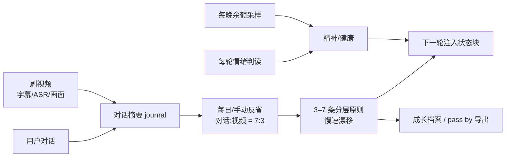

# 鱼的反思 · dsh-fish-reflection


给 DSH 主会话一个**会缓慢自我修订的人格状态层**：它白天和你相处、读视频，夜里反省，把经历沉淀成几条自己写的三观，并把每次变化写进成长档案。

> 一句话：反思不保证让它变好，只保证它的改变是**有上限、有记录、不恶化的**。

---

## 这是什么，不是什么

**是什么**

- 一个**人格/反思层**：维护 3–7 条分层原则（价值观 / 偏好 / 习惯），每天最多小改 2 条；
- 一个**状态层**：精神（每轮情绪读数）、健康（慢均线）、财务（每晚账户余额样本）三个外循环；
- 一个**可审计的成长档案**：每次反省的原则、权重、本次说明、审稿退回记录都保留；
- 一个**内容摄入器**：B站/抖音（游客模式）视频 → 字幕/本地 ASR/画面描述 → 笔记 → 反省素材。

**不是什么**

- ❌ 不是记忆插件：**不存事实、不做检索**（记忆请配 `dsh-fish-memory` / OpenViking 等）；
- ❌ 不是角色卡：人格是模型自己写、自己改的，不是提示词里固定的人设；
- ❌ 不是“让 AI 更像人”的多模态套件：语音/形象属于表现层，本项目不解决；
- ❌ 没有任何“效果更好”的承诺：它只维护连续性，不承诺成长质量。

---

## 特性

| 能力 | 说明 |
|---|---|
| 分层人格 | `value` 价值观 / `preference` 偏好 / `habit` 习惯；注入时按层取高权重（2/2/3），每条截 60 字 |
| 慢速漂移 | 保留原文的条目每次最多调整 0.15 权重；新条目权重 ≤ 0.6；每次反省最多接受 2 条新增/改写 |
| 反谄媚 | 提示词规则 + 确定性过滤 + 一次廉价审稿（fail-open）；不把“用户称赞”当改变价值观的证据 |
| 状态注入 | 每轮在输入末尾追加一条带来源标记的 user 消息（append-only），不改系统提示前缀，KV Cache 友好 |
| 情绪/健康 | 每轮用默认模型同步判一次用户情绪（约 1 秒、3 秒兜底），健康是慢速滚动均值 |
| 财务外循环 | 每晚读一次账户余额并记账，模型只看到余额与近 N 天日均（不伪造历史） |
| 刷视频 | B站热门/生活区；抖音分享链接队列；字幕 → 本地 ASR → 画面（本地 Ollama 或外部多模态 API）→ 笔记 |
| 成长档案 | `history.jsonl` + 可导出到 `pass by/` 的三份 Markdown（当前状态/成长档案/视频心得） |
| 本地优先 | 状态与配置都在 `~/.dsh/` 下；语音、视觉、抖音解析都可选，不配也能只用对话反省 |

---

## 工作方式



- **反省的触发**：`settlementTime`（默认 23:30）之后；或启动/新建会话时补做（两次自动反省之间至少 4 小时）；也可在设置页手动「立即反思」。
- **反省的输入**：自上次反省以来的全部主会话摘要 + 视频笔记；视频笔记最多占实际使用字符的 30%。
- **反省的输出**：3–7 条原则 + 一句话说明；写入前经过确定性过滤与审稿，失败/异常一律保留原人格。
- **注入**：只对设置页勾选的主会话生效；子代理/委派会话不参与。

---

## 快速开始

### 1. 环境

- **DSH**（DeepSeek Harness）桌面端或 `dsh web`，带 Web 设置页；
- 可选（按需）：
  - `ffmpeg`：本地 ASR、抽帧需要；
  - **Ollama + qwen2.5vl:3b**：本地视觉；
  - `voice-input/` 能力 bundle + SenseVoice 模型：本地 ASR；
  - **Edge/Chrome** 与 `yt-dlp`：抖音解析兜底；
  - 任意 OpenAI 兼容**多模态**API：替代本地视觉写笔记。

### 2. 安装本插件

```bash
https://github.com/<Najiya5>/dsh-fish-reflection
dsh plugin --profile desktop add ./dsh-fish-reflection
```

或在 DSH **设置 → 插件 → 安装**里选择本目录（本地 bundle 安装）。


## 设置项（部分）

| 选项 | 默认 | 说明 |
|---|---|---|
| `autoReflection` | `true` | 是否自动反省 |
| `minMaterial` | 6 | 至少多少条摘要才允许改写人格 |
| `settlementTime` | `23:30` | 每日结算时间（余额采样 + 反省） |
| `injectionIntervalTurns` | 1 | 每 N 轮注入一次状态块 |
| `emotionTimeoutMs` | 3000 | 情绪判读硬超时 |
| `intakeEnabled` | `true` | 刷视频总开关 |
| `autoIntake` | `false` | 是否每小时自动刷一个 |
| `feedSources` | `bilibili`+`douyin` | 平台开关 |
| `bilibiliCookie` / `douyinCookie` | 空 | 游客模式；Cookie 明文存本机 `options.json` |
| `analyzerBaseUrl` / `analyzerApiKey` / `analyzerModel` | 空 | 可选外部分析 API（需同时支持多模态与 ASR） |
| `asrLanguage` / `asrMaxSeconds` | `zh` / 600 | 本地 ASR 语言与单视频转写上限 |
| `visionFrames` | 6 | 抽帧数 |

运行时设置写入 `~/.dsh/fish-reflection/options.json`；改设置不需要重载插件。

---

## 隐私与安全（请务必读）

- **本地数据**：
  - 状态域 `~/.dsh/storages/fish_reflection.json`（三观/精神/健康/余额/摘要）
  - 运行目录 `~/.dsh/fish-reflection/`（`options.json`、`scope.json`、`intake.json`、`history.jsonl`）
- **会离开本机的内容**：
  - 反省/笔记/情绪判读会把对话摘要、视频材料发给**你当前配置的默认模型提供方**；
  - 若配置了外部分析 API，视频帧与转写文本会发往该 API；
  - 余额数字会随状态块注入，因此也会发给默认模型提供方。
- **不会离开本机**：Cookie/API Key 只用于对应服务请求；本插件接口只回传“是否已配置”，不回传原文。
- **已知边界**：本机 JSON 里的 Cookie/API Key 是**明文**；插件本地 API 只有同源检查、没有 token；请勿把 DSH GUI 暴露到不可信网络或共享给他人。
- 抖音链接只接受抖音自有域名（`douyin.com`/`iesdouyin.com`/`douyinvod.com` 等），其他链接会被拒绝；媒体下载不携带 Cookie。
- **只粘贴可信来源的链接**；外部视频内容可能被投毒，插件已做提示词层隔离，但不是安全过滤器。

---

## 已知限制

- 没有事实记忆/检索：它能记得“自己成了谁”，记不起“你上周说过什么”。
- 反省质量主观、不可测；人格条目在模型没有原文回显旧条目时可能减少（设计上限制了新增，但没有强制下限）。
- 自动反省可能在启动/新建会话时补做，并非严格“每天恰好一次”。
- 本地 ASR 默认只转写每个视频前 600 秒；唱歌/纯音乐转写质量差。
- 视觉只抽 6 帧，能读场景/人物/画面文字，看不懂连续动作。
- 抖音解析依赖 Edge/Chrome + yt-dlp + 新鲜 Cookie，可能失败；B站字幕需要 Cookie。
- 外部 API 失败会自动回退本地链路；本地 Ollama 路径需要能被自动发现或手动配置。
- 本项目定位为**实验/娱乐**，不提供医疗、心理或财务建议。

---

## 开发与测试

```bash
node test/reflect.test.mjs   # 反谄媚过滤 / 审稿解析 / 慢速漂移
node test/ui.test.mjs        # 设置页渲染
node test/security.test.mjs  # 抖音域白名单 / options 原子写
```

更多：[docs/DESIGN.md](docs/DESIGN.md)（架构与设计取舍）、[docs/文献综述-反思与三观.md](docs/文献综述-反思与三观.md)（文献对照）、[docs/横向对比-人性化方案.md](docs/横向对比-人性化方案.md)（与记忆/语音/人设类方案的对比）。

## License

[MIT](LICENSE)
